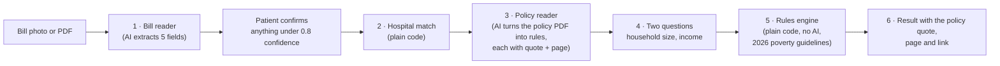

# BillBack

**You may not owe this bill. BillBack finds out in 60 seconds and fills out the form.**

Take a photo of a hospital bill. BillBack reads it, finds that hospital's financial assistance policy, asks two questions (household size and yearly income), and tells you whether you likely qualify for free or discounted care, quoting the exact line of the hospital's own policy.

- Demo: TODO_DEMO_URL
- Video: TODO_VIDEO_URL

Built at EvoHacks II.

## The problem

Nonprofit hospitals have to offer free or discounted care to low-income patients, but most patients never hear about it. Hospitals reported sending **$2.7 billion** in bills over one year to patients who probably qualified for free or discounted care ([KFF Health News, 2019](https://kffhealthnews.org/news/patients-eligible-for-charity-care-instead-get-big-bills/)).

The rules are buried in long PDF policies that differ from hospital to hospital. The nonprofit Dollar For has helped file more than 17,000 applications and get more than $60 million in medical debt relieved. To do that, its staff read every hospital policy by hand, with two researchers checking each one ([Messac et al., *Health Affairs*, 2024](https://pmc.ncbi.nlm.nih.gov/articles/PMC12230784/)).

## Who it's for

Uninsured or underinsured people with low incomes who got a hospital bill, and the family members who handle the paperwork for them.

## How it works



1. **Bill reader** reads hospital name, address, amount due, service date and account number from a photo or PDF. Every field has a confidence score. Code checks each value (amount parses to cents, date is real and not in the future, account number format, and for text PDFs, the value really appears in the text).
2. **Hospital match** finds the hospital in our list of read policies (fuzzy name match plus a state check). If it's not there, the patient picks it.
3. **Policy reader** turns the hospital's financial assistance policy into rules: the free-care income limit, discount limits and tiers, asset test, residency rule and how long you have to apply. Each rule carries a word-for-word quote, a page number and a confidence score, and code checks that the quote really is in the PDF. Policies are read once and cached.
4. **Two questions:** household size and yearly income.
5. **Rules engine** (plain Python, tested) compares income with the policy's limits using the 2026 HHS poverty guidelines. AI is not involved in this step.
6. **Result:** likely free, likely discounted, probably not eligible, or "we can't tell", with the exact policy quote, the page and a link to the hospital's PDF.

More detail: [docs/architecture.md](docs/architecture.md).

## Results

| Test | Measured | Target | Result |
|---|---|---|---|
| Bill extraction (10 fake bills × 5 fields) | 50/50 (100%) | ≥ 90% | ✅ met |
| Policy reader, hand spot-checks (2 real policies × 6 fields) | 11/12 (Boys Town 6/6, USA Health 5/6) | ≥ 90% | ✅ met (small sample, checked by hand) |
| Policy reader, 120-field answer key | not measured (no field-level key for real PDFs) | ≥ 90% | — not measured |
| Policy quotes verified verbatim in the PDF | 21/21 | all | ✅ met |
| Policy re-run agreement (6 policies × 5 values) | 29/30 | — | info |
| End-to-end households, status (10 households × 20 policies, 2026 FPL) | 10/10 households (200/200 results) | 10/10 | ✅ met |
| …same, every detail incl. unresolved-rule notes | 7/10 households (193/200) | — | info (B to confirm 7 notes) |
| Rules-engine + backend tests | 215 passed, 0 failed, 2 skipped | all pass | ✅ met |
| Speed, bill → result (cached policy) | avg 2.6 s, max 3.3 s | < 60 s | ✅ met |
| Speed, first bill for a new hospital (live policy read) | avg 10.9 s | < 60 s | ✅ met |
| Cost per bill (cached policy) | $0.0096 | < $0.05 | ✅ met |
| Cost, first bill for a new hospital | $0.0528 | < $0.05 | ❌ not met |
| Bill fields sent to the patient to confirm | 2/50 (under 0.8 confidence: 2) | — | info |
| Policy fields sent to human review | 4/30 | — | info |

How these were measured: [eval/results/SUMMARY.md](eval/results/SUMMARY.md) (rebuild with `python -m eval.summary`). Per-bill misses, per-field tables and every changed answer are in `eval/results/`.

**The policy reader was not measured against a full answer key.** Nobody hand-labeled real policy PDFs field by field, so the "90% of 120 fields" target was not tested. What we have: two policies checked by hand (11 of 12 fields right), every quote we show verified word for word in the PDF, and the same answers on 29 of 30 values when the reader ran twice.

## Responsible use of AI

- **AI only extracts.** It reads text off the bill and the policy. Plain code makes the eligibility call.
- **Every value can be checked.** Each policy rule has a word-for-word quote, a page number and a confidence score. Code confirms the quote appears in the PDF; if it doesn't, the rule is flagged and its confidence is capped.
- **Low confidence goes to a person.** Any bill field under 0.8 confidence, or one that fails a check, is shown to the patient to confirm or fix. Unclear policy rules are reported as "we still need to know", never treated as a pass.
- **The patient stays in control.** BillBack never contacts the hospital. Results say "Likely eligible, not a guarantee." The hospital makes the final decision.
- **Data:** BillBack doesn't save bills. Uploads are read in memory and never written to disk. The bill image (or its text) is sent to the Anthropic API to be read. Only public hospital policies are cached. Every bill and household in this repo is fictional.

## Limits (honest)

- **"Likely", not a guarantee.** Policies have exceptions (insurance status, which services, which facility), and the hospital decides.
- **Policies contradict themselves.** USA Health's policy gives the application deadline as 240 days after the first bill in one section and 240 days after the date of service in another. BillBack flags this for review instead of picking one silently.
- **Form vs. policy.** The first read of Adena Health took an asset test from a checkbox on the application form, not from a policy rule. It was flagged at 0.6 confidence; after a prompt fix it is now marked "unclear".
- **Run-to-run variation.** On a re-run, Fort HealthCare's 12-row discount table came back as one "sliding scale 201–400%" tier. The free-care limit was the same both times.
- **Watermarks and scans.** pdfplumber mixed a "COPY" watermark into USA Health's text. OCR (tesseract) wasn't installed on our build machine, so scanned pages are sent to the model as a PDF and their quotes can't be verified.
- **Source documents.** Two of the policy links we were given point to an application form (Duke) and a clinic sliding-fee schedule (Heartland), not a hospital policy. Both are flagged for review. 6 of 20 hospital links failed to download (403/404 or no PDF).
- **Not covered:** state charity-care laws, insurance statements (EOBs), billing-error detection, and the filled-in application packet (the button says "coming in the next version").
- **Cost:** the first bill for a hospital we haven't read yet costs about $0.053, just over our $0.05 target, because the policy has to be read once.
- **Asset questions:** the app doesn't ask about savings yet, so hospitals with an asset test (USA Health, Boys Town) return "we can't tell" until it does. The API already accepts `assets_usd`.

Need help now? [Dollar For](https://dollarfor.org) helps people apply for free, or call the hospital's billing office and ask for a financial assistance application.

## Run it locally (macOS)

Needs Python 3.11+ and Node 20+.

```bash
git clone https://github.com/MarvinRidgeMT/BillBack.git
cd BillBack
python3.12 -m venv .venv
.venv/bin/pip install -r requirements.txt
cp .env.example .env          # then put your ANTHROPIC_API_KEY in .env
```

Optional, for scanned PDFs: `brew install tesseract poppler`.

Start the backend (port 8000) and the front end (port 3000) in two terminals:

```bash
.venv/bin/uvicorn backend.app:app --port 8000
```

```bash
cd frontend && npm ci && npm run dev
```

Open http://localhost:3000 and use a bill from `sample_bills/`.

**No API key?** Run the backend in demo mode. The 10 sample bills and all cached policies work with no model calls:

```bash
BILL_CACHE_ONLY=1 DEMO_CACHE_ONLY=1 .venv/bin/uvicorn backend.app:app --port 8000
```

Tests: `.venv/bin/pytest -q`. Evals (live model calls, about $0.10): `.venv/bin/python -m eval.bill_extraction`, then `python -m eval.households`, `python -m eval.policy_reader`, `python -m eval.speed_cost`, `python -m eval.summary`.

Command-line tools:
- `python -m backend.bill_reader.cli sample_bills/bill_01_clean.jpg`
- `python -m backend.policy_reader.cli data/policies/usa-health-al.pdf` (or `--all data/policies/`)
- `python -m backend.e2e_cli sample_bills/bill_10_crumpled_dim.jpg --household 3 --income 40000 --state WI`

## API

All responses use `{"success": true, "data": ..., "error": null}`.

| Route | What it does |
|---|---|
| `POST /api/bill/read` | multipart `file` (JPG/PNG/HEIC/PDF, ≤ 15 MB) → 5 fields with confidence, `fields_to_confirm`, `seconds`, `model` |
| `GET /api/hospitals` | every hospital with a read policy: `[{slug, name, state}]` |
| `POST /api/hospitals/match` | `{hospital_name, hospital_address}` → `{slug, score, matched}` (matched only if score ≥ 80) |
| `POST /api/eligibility` | `{hospital_slug, household_size, annual_income, state, assets_usd?}` → status, tier, policy quote, caveats |
| `POST /api/policy/read` | multipart `file` (policy PDF) or `{"url": ...}` (beta) → rules JSON with quotes |
| `GET /api/health` | liveness check |

Example:

```bash
curl -s localhost:8000/api/eligibility -H 'content-type: application/json' \
  -d '{"hospital_slug":"fort-healthcare-inc","household_size":3,"annual_income":40000,"state":"WI"}'
```

```json
{"success": true, "data": {
  "status": "likely_free",
  "percent_of_fpl": 146.41,
  "evidence": {"quote": "Persons whose income is at or up to 200% of the guidelines will be considered for complete forgiveness of their outstanding bill.",
               "page": 1, "verified": true, "status": "stated",
               "source_url": "https://www.forthealthcare.com/wp-content/uploads/2025/03/Financial-Assistance-Policy-2025-Final-English-1.pdf"},
  "disclaimer": "Likely eligible, not a guarantee.",
  "fpl_year": 2026, "fpl_used": "27320", "engine": "rules"}, "error": null}
```

(Trimmed; the full response also has `tier`, `caveats`, `explanation`, `missing_facts` and engine details.)

## Data

- **Poverty guidelines:** 2026 HHS poverty guidelines, Federal Register document 2026-00755 (Jan 15, 2026), in `data/fpl_2026.json`.
- **Hospital policies** (public PDFs, downloaded 2026-11-22, in `data/policies/`; rules read from them are in `cache/policies/`):

  | Hospital | State | Policy |
  |---|---|---|
  | Fort HealthCare | WI | [PDF](https://www.forthealthcare.com/wp-content/uploads/2025/03/Financial-Assistance-Policy-2025-Final-English-1.pdf) |
  | Marshfield Clinic Health System | WI | [PDF](https://www.marshfieldclinic.org/-/media/marshfieldclinic/files/shared/financial-assistance-policy-english.pdf) |
  | Adena Health System | OH | [PDF](https://www.adena.org/docs/default-source/default-document-library/financial-assistance-policy.pdf?sfvrsn=2b0b72c7_3) |
  | USA Health | AL | [PDF](https://www.usahealthsystem.com/uploads/pdfs/financial-assistance/usa-financial-assistance-policy-202505.pdf) |
  | Baptist Memorial Health Care (system policy hosted on och.org) | MS | [PDF](https://www.och.org/wp-content/uploads/2025/10/S-FI-3025-15-Hospital-Financial-Assist-Policy-Final-05-25.pdf) |
  | Boys Town National Research Hospital | NE | [PDF](https://media.boystown.org/image/upload/v1755542976/Financial-Assistance-Policy.pdf) |
  | Banner Health |  | [PDF](https://www.bannerhealth.com/-/media/Files/Project/BH/Patients-Visitors/Billing/Financial-Assistance/2025-documents/Banner-Health-Financial-Assistance-Policy-for-Hospital-Patients-770-v6092925100125.pdf) |
  | Baptist Health South Florida | FL | [PDF](https://baptisthealth.net/patient-resources/billing-and-financial-assistance/financial-assistance-program/-/media/Documents/Patient-Resources/Financial-Assistance/Feb-2025/BHSF35514--Financial-Assistance-Policy-ENG-9262024-FINAL-updated-income-levels-2025-v2.pdf) |
  | BayCare Health System | FL | [PDF](https://baycare.org/-/media/project/baycare/consumer-portal/billing-and-insurance/financial-assistance/financial-assistance-policies/26-12663-financial-full-policy-english.pdf) |
  | Children's Hospital Colorado | CO | [PDF](https://www.childrenscolorado.org/globalassets/your-visit/financial-assistance-payment-plan-english.pdf) |
  | Deaconess Regional Healthcare Services Illinois, Inc. (Heartland Regional Medical Center) | IL | [PDF](https://redbudregional.com/wp-content/uploads/2025/12/DRHSI-Financial-Assistance-Policy-102725-final.pdf) |
  | Duke University Health System | NC | [PDF](https://www.dukehealth.org/sites/default/files/general_page/DUHSFinancialAssistanceApplication-English_2021.pdf) |
  | Emory Healthcare | GA | [PDF](https://www.emoryhealthcare.org/-/media/Project/EH/Emory/ui/pdfs/financial-information/13-hospitals-policies-regarding-charity-care-reduced-cost-services/financial-assistance-policy-20260521.pdf) |
  | Heartland Health Services | IL | [PDF](https://www.hhsil.com/file/21/English%20FA%20Application%20002.pdf) |
  | Novant Health (North Carolina Hospitals, Provider-based clinics) | NC | [PDF](https://www.novanthealth.org/globalassets/buttons-and-documents-ctaslinks/documents-pdfs/financial-assistance-policy-nc-hospitals.pdf?v=2) |
  | Texas Health Resources (Texas Health) | TX | [PDF](https://www.texashealth.org/-/media/Project/THR/shared/Documents/PDFs/Business-Office/Financial-Assistance/Financial-Assistance-Policy/Financial-Assistance-THR-System-Policy.pdf) |
  | UCHealth | CO | [PDF](https://uchealth-wp-uploads.s3.amazonaws.com/wp-content/uploads/2025/04/07133352/Financial-Assistance-Policy_03-27-2025-English.pdf) |
  | UW Medicine (Harborview Medical Center, UW Medical Center, Airlift Northwest, UW Physicians, UW Medicine Primary Care) | WA | [PDF](https://doh.wa.gov/sites/default/files/2024-02/CCPUW.pdf) |
  | Washington Hospital Healthcare System | CA | [PDF](https://www.washingtonhealth.com/documents/financial-assistance-charity-care-policy-2026.pdf) |

- **Synthetic data:** 20 synthetic policies, 10 households and the engine answer key (`data/policies/HOSP-*.json`, `data/households/`, `data/answer_key.json`), and 10 sample bills (`sample_bills/`). **All bills and households are fictional.**

## Built during EvoHacks II

All application code in this repository was written during the event. The commit history is the proof: the first commit is `ffe1677 2026-11-22 00:11:53 (ET, UTC−5)`, and the last commit before this README is `abfdb1d 2026-11-22 11:14:39 (ET, UTC−5)`.

Things we used that existed before the event:
- **Python libraries** (`requirements.txt`): FastAPI, Uvicorn, python-multipart, Anthropic SDK, Google GenAI SDK (optional provider), pdfplumber, pytesseract, pdf2image, httpx, pydantic, RapidFuzz, python-dotenv, pytest, ReportLab, Pillow, pillow-heif.
- **Front-end libraries** (`frontend/package.json`): Next.js, React, Tailwind CSS, Motion, Lucide icons, Base UI, shadcn, class-variance-authority, tw-animate-css; fonts Anton and DM Sans (Google Fonts via `next/font`).
- **APIs:** Anthropic Claude API (Claude Sonnet 5.5) for reading bills and policies.
- **Data:** the 2026 HHS poverty guidelines and public hospital financial assistance policies (listed above).
- **Tools:** we used Claude Code (an AI coding assistant) while building. The prompts we gave it are in `docs/process/`.

## Team

- **TODO_NAME (A):** AI and backend: policy reader, bill reader, poverty-line math, integration, evals.
- **TODO_NAME (B):** eligibility rules engine, policies, answer key, households, engine tests.
- **TODO_NAME (C):** front end, sample bills, design, video.

## License

MIT, see [LICENSE](LICENSE).
