# BillBack architecture

```mermaid
flowchart LR
    A["📄 Bill photo or PDF<br/>(patient's phone)"] --> B["1 · Bill reader<br/>Claude Sonnet 5.5 vision<br/>5 fields + confidence"]
    B --> C{"Any field<br/>&lt; 0.8 confidence<br/>or failed check?"}
    C -- yes --> D["Patient confirms<br/>or fixes it"]
    C -- no --> E
    D --> E["2 · Hospital match<br/>rapidfuzz + state check"]
    E --> F["3 · AI policy reader<br/>Claude Sonnet 5.5 → rules JSON<br/>quote + page + confidence per rule<br/>(cached per hospital)"]
    F --> G["Code checks<br/>quote found word for word?<br/>numbers sane?"]
    G --> H["4 · Patient answers<br/>household size + income"]
    H --> I["5 · Rules engine<br/>plain Python, no AI<br/>2026 HHS poverty guidelines"]
    I --> J["6 · Result<br/>likely free / discounted / not eligible / can't tell<br/>+ exact policy quote, page, link<br/>'Likely eligible, not a guarantee.'"]
```

**Where AI is used:** only steps 1 and 3, and only to *extract* text into fields. Every extracted value carries a confidence score; policy rules also carry a verbatim quote and page number that code checks against the PDF.

**Where AI is not used:** hospital matching, the poverty-line math, and the eligibility decision (step 5) are plain code with tests.

**We don't save your bill or answers:** the bill image is sent to the AI provider to be read, processed in memory, and discarded by our server. No accounts, no trackers. Only the public hospital policies are cached.

| Piece | Code |
|---|---|
| Bill reader | `backend/bill_reader/` |
| Hospital match | `backend/policies.py` |
| Policy reader | `backend/policy_reader/` |
| Poverty guidelines | `backend/fpl.py`, `data/fpl_2026.json` |
| Rules engine | `billback/eligibility.py` (B), bridged by `backend/eligibility.py` |
| API | `backend/app.py` (FastAPI) |
| Front end | `frontend/` (Next.js, C) |
